# DP2 AnaCal v0 — TXPipe run

[← back to DP2 v0](../README.md)

TXPipe (LSSTDESC/TXPipe, branch `AnaCal_ingestion` @ `2bbf0b5a`) on the DP2 v0
AnaCal catalog, all 820 tracts, one source bin, no blinding — run twice, with and
without the AnaCal healsparse footprint mask.

| | |
|---|---|
| input | `u/xiangchl/anacal-v0/merge_withz_updated` (PSF moments in arcsec², `psf_g` shear-type) — 146.34 M objects (this run: ingested from `merge_withz`, then converted in place to the same values) |
| mask | `rubin_dp2_wide_anacal_mask_0.2.0.hsp` (data registry, user `smau`), applied by `TXCutShearCatalog`; skipped in the no-mask run |
| source bin | photo-z `zmode` ∈ [0.1, 3.0] |
| ξ± | TreeCorr, 2.5′–240′, 20 bins, `flip_g2: false` (AnaCal shapes are in the u = West frame), mean shear subtracted, 50 jackknife patches |

## Selection (`TXSourceSelectorAnaCal`)

| cut | value |
|---|---|
| masked fraction `n_mask_base` | < 0.035 |
| i-band S/N `lsst_i_s2n_fpfs1` | > 10 |
| size (m00 + m20)/m00 | > 0.15 |
| \|ε\| | < 0.4 |
| `lsst_i_mag_gauss2` | < 24 |
| colour \|r−i\|, \|i−z\| | < 1.5, < 1.5 |
| PSF ellipticity \|g₁\|, \|g₂\| (shear-type `psf_g`) in r, i, z | < 0.035 (≈ distortion 0.07) |
| `flux_gauss2_err` r / i / z [nJy] | < 200 / 400 / 600 |

The selection response R_sel (±0.01 re-selection) is included in R. The diagnostics2
selection of the [null tests](../null_tests.md) differs in colour (1.3 / 1.0) and
PSF (0.06) and applies no healsparse mask.

## Results

| | N | R | σ_e | ⟨γ₁⟩ | ⟨γ₂⟩ | ξ+ amplitude | ξ− amplitude |
|---|---|---|---|---|---|---|---|
| masked | 14.62 M | 0.329 | 0.366 | −0.000028 | +0.00035 ± 0.00010 | 0.93 ± 0.07 | 0.95 ± 0.20 |
| no mask | 25.76 M | 0.289 | 0.413 | +0.000002 | +0.00022 | 1.11 ± 0.06 | 1.06 ± 0.19 |

Amplitudes are relative to the CCL fiducial (`data/fiducial_cosmology.yml`, n(z) from the
selected photo-z), 5′–100′, TXPipe jackknife covariance. The per-bin mean shear agrees with
the xlens diagnostics to < 0.05σ on the same sample.

## Figures

| | masked | no mask |
|---|---|---|
| mean shear vs i-band PSF g | 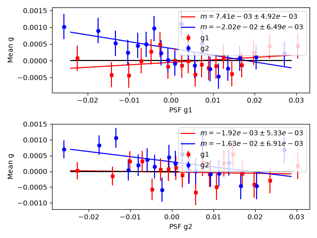 | 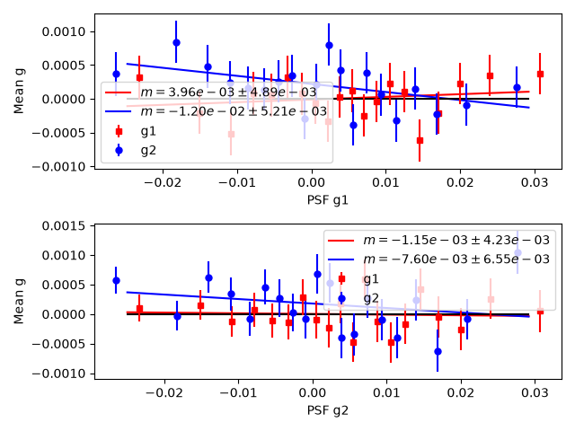 |
| mean shear vs PSF T [arcsec²] | 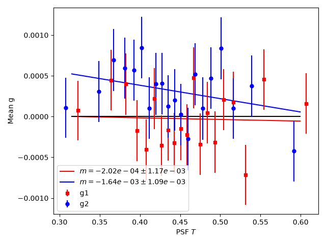 | 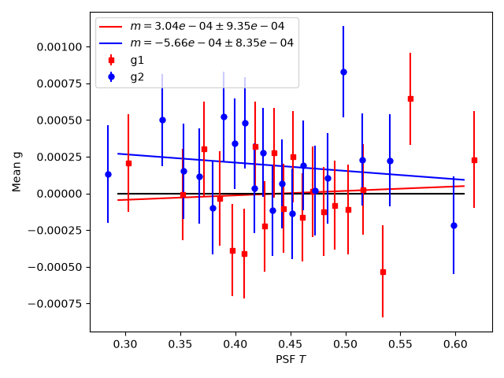 |
| mean shear vs S/N | 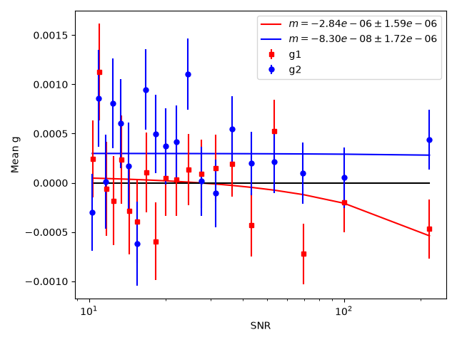 | 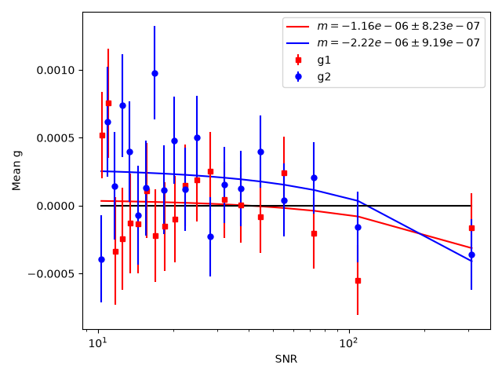 |
| mean shear vs size T | 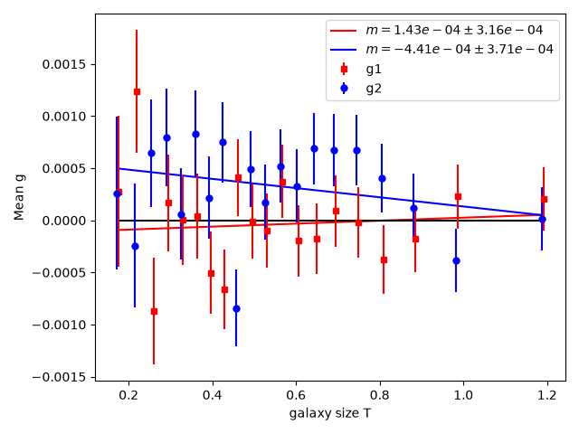 | 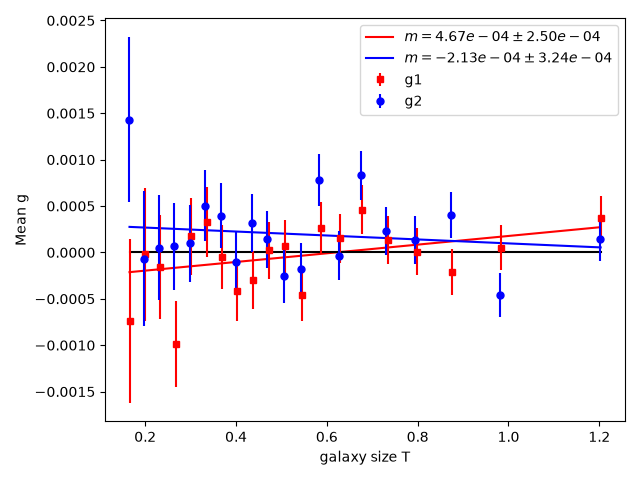 |
| mean shear vs colour–magnitude | 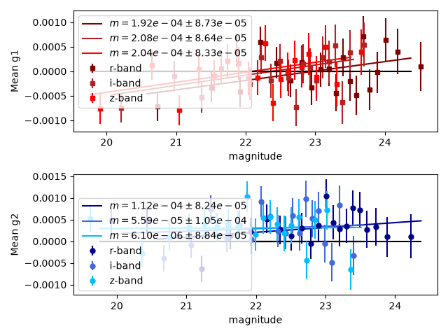 | 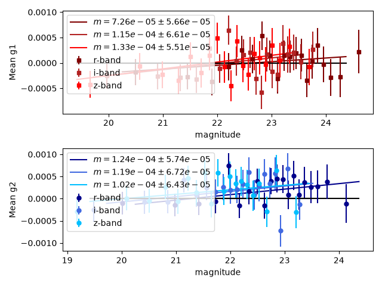 |
| θ ξ+ | 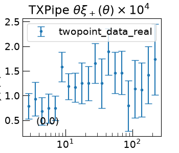 | 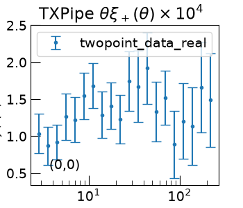 |
| θ ξ− | 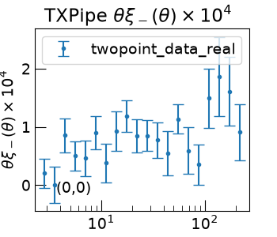 | 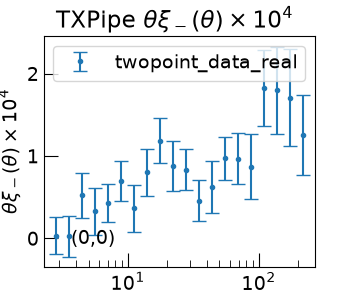 |

`g_psf_g` uses the i-band PSF in the shear-type convention (g ≈ e/2 of the null-test
plots), in 20 quantile bins of `psf_g1` — TXPipe reuses those edges for the `psf_g2`
panel. The ξ± panels are TXPipe's one-bin layout (small canvas, clipped labels).

## Running

`scripts/` — names follow TXPipe's `examples/dp2/`:

| file | |
|---|---|
| `anacal_ingestion.yml`, `run_ingest.sbatch` | tract list + `TXIngestAnacal` + mask → `data/dp2_fullcatalogs/` (LSST stack env) |
| `anacal_analysis.yml`, `run_analysis.sbatch` | masked analysis → `data/anacal_dp2/` (image env, has sacc) |
| `anacal_analysis_nomask.yml`, `run_analysis_nomask.sbatch` | no-mask analysis → `data/anacal_dp2_nomask/` |
| `anacal_config.yml`, `anacal_config_nomask.yml` | stage settings (the no-mask copy only moves the TreeCorr patch cache) |

```bash
sbatch scripts/run_ingest.sbatch
sbatch --dependency=afterok:<ingest> scripts/run_analysis.sbatch
sbatch --dependency=afterok:<ingest> scripts/run_analysis_nomask.sbatch
```

Outputs live under `/pscratch/sd/x/xiangchl/dp2/txpipe_test/`; ξ± are in
`data/<case>/twopoint_data_real_raw.sacc`. `TXMapPlots` is off (fails with the current
matplotlib).
